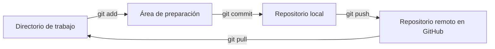
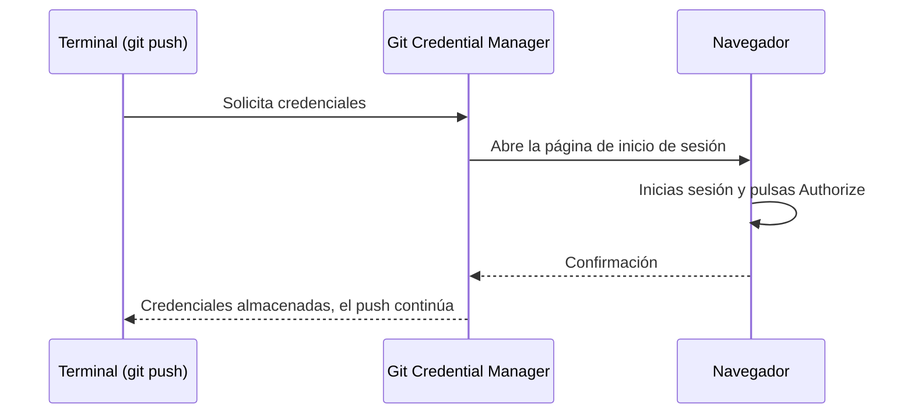

# Práctica: Introducción al control de versiones con Git y GitHub

**Preparación del entorno, flujo básico de trabajo y entrega de prácticas mediante repositorios**

| | |
|---|---|
| **Duración** | 145 minutos (aprox.). Puede repartirse en dos sesiones: Bloques 1 a 5 y Bloques 6 a reto |
| **Modalidad** | Individual |
| **Nivel** | Inicial. No se requieren conocimientos previos de Git, GitHub ni de la terminal |
| **Resultado** | Entorno de trabajo operativo y un repositorio propio en GitHub con historial, ramas y documentación en Markdown |

---

## Índice

1. [Objetivos](#1-objetivos)
2. [Requisitos previos](#2-requisitos-previos)
3. [Planificación](#3-planificación)
4. [Bloque 1. Instalación de Visual Studio Code](#4-bloque-1-instalación-de-visual-studio-code-10-min)
5. [Bloque 2. Instalación y configuración de Git](#5-bloque-2-instalación-y-configuración-de-git-15-min)
6. [Bloque 3. Cuenta de GitHub](#6-bloque-3-cuenta-de-github-10-min)
7. [Bloque 4. Conceptos fundamentales](#7-bloque-4-conceptos-fundamentales-10-min)
8. [Bloque 5. Primer repositorio: clonado, commit y autenticación](#8-bloque-5-primer-repositorio-clonado-commit-y-autenticación-20-min)
9. [Bloque 6. Ciclo de trabajo diario](#9-bloque-6-ciclo-de-trabajo-diario-25-min)
10. [Bloque 7. Sincronización con el repositorio remoto](#10-bloque-7-sincronización-con-el-repositorio-remoto-10-min)
11. [Bloque 8. Ramas y Pull Request](#11-bloque-8-ramas-y-pull-request-15-min)
12. [Reto final](#12-reto-final-30-min)
13. [Evaluación y entrega](#13-evaluación-y-entrega)
14. [Resolución de incidencias](#14-resolución-de-incidencias)
15. [Referencia rápida de comandos](#15-referencia-rápida-de-comandos)
16. [Referencias](#16-referencias)

---

## 1. Objetivos

Al finalizar la práctica serás capaz de:

- Instalar y configurar **Visual Studio Code** y **Git**.
- Crear una cuenta de **GitHub** y autenticar tu equipo de forma segura.
- Distinguir entre **Git** (herramienta local) y **GitHub** (plataforma remota).
- Explicar el recorrido de un cambio: directorio de trabajo, área de preparación, repositorio local y repositorio remoto.
- Utilizar los comandos esenciales: `clone`, `status`, `add`, `commit`, `diff`, `log`, `restore`, `push` y `pull`.
- Excluir archivos del control de versiones con `.gitignore`.
- Trabajar con **ramas** y fusionarlas mediante un **Pull Request**.
- Redactar documentación básica en **Markdown**.
- Entregar una práctica como un repositorio con un historial claro y ordenado.

---

## 2. Requisitos previos

| Requisito | Motivo |
|---|---|
| Equipo con Windows, macOS o Linux | Instalar el software |
| Conexión a internet | Descargas e inicio de sesión |
| Dirección de **correo electrónico** a la que tengas acceso | Crear y verificar la cuenta de GitHub |
| Permisos de instalación | En equipos del centro, solicita la instalación al profesor o responsable |

> **Convenciones de este documento.** Los valores en mayúsculas, como `USUARIO`, deben sustituirse por los tuyos. Los comandos se escriben en la terminal de VS Code, sin el símbolo `$` inicial. Las instrucciones detalladas corresponden a **Windows**; al final de los bloques 1 y 2 se indican las diferencias para macOS y Linux.

---

## 3. Planificación

| Bloque | Contenido | Tiempo |
|:---:|---|:---:|
| 1 | Instalación de Visual Studio Code | 10 min |
| 2 | Instalación y configuración de Git | 15 min |
| 3 | Cuenta de GitHub | 10 min |
| 4 | Conceptos fundamentales | 10 min |
| 5 | Primer repositorio: clonado, commit y autenticación | 20 min |
| 6 | Ciclo de trabajo diario | 25 min |
| 7 | Sincronización con el repositorio remoto | 10 min |
| 8 | Ramas y Pull Request | 15 min |
| 9 | **Reto final** | 30 min |

---

## 4. Bloque 1. Instalación de Visual Studio Code (10 min)

**Visual Studio Code** (VS Code) es un editor de código gratuito de Microsoft. Se utilizará para editar archivos y documentos Markdown. Incluye terminal y herramientas de Git integradas.

### 4.1 Descarga

1. Accede a **https://code.visualstudio.com**.
2. Pulsa el botón de descarga. La página detecta automáticamente tu sistema operativo.
3. Espera a que finalice la descarga (en Windows, un archivo `VSCodeUserSetup-...exe`).

> El instalador de usuario (*User Setup*) no requiere permisos de administrador.

### 4.2 Instalación en Windows

1. Ejecuta el archivo descargado.
2. Acepta el acuerdo de licencia y pulsa **Siguiente**.
3. Mantén la carpeta de destino por defecto y pulsa **Siguiente**.
4. En *Seleccionar tareas adicionales*, marca:
   - *Añadir la acción «Abrir con Code» al menú contextual de archivos*.
   - *Añadir la acción «Abrir con Code» al menú contextual de directorios*.
   - *Añadir a PATH* (suele venir marcada).
5. Pulsa **Instalar** y, al terminar, **Finalizar**.

### 4.3 Verificación

Abre Visual Studio Code desde el menú de inicio. Debe mostrarse la pantalla de bienvenida.

### 4.4 Extensiones recomendadas

Abre el panel de extensiones con `Ctrl + Shift + X` e instala:

| Extensión | Utilidad |
|---|---|
| **Markdown All in One** | Atajos y utilidades para escribir Markdown |
| **Spanish Language Pack for Visual Studio Code** (opcional) | Interfaz en español. Requiere reiniciar el editor |

### 4.5 Otros sistemas operativos

| Sistema | Procedimiento |
|---|---|
| **macOS** | Arrastra `Visual Studio Code.app` a la carpeta *Aplicaciones* |
| **Linux** | Instala el paquete `.deb` (Debian/Ubuntu) o `.rpm` (Fedora) descargado, por ejemplo con `sudo apt install ./archivo.deb` |

---

## 5. Bloque 2. Instalación y configuración de Git (15 min)

**Git** es el programa que registra el historial de cambios de tus archivos. Se instala de forma independiente a VS Code.

### 5.1 Descarga

1. Accede a **https://git-scm.com/downloads**.
2. Selecciona **Windows** y descarga el instalador de 64 bits (*Git for Windows Setup*).

### 5.2 Instalación en Windows

El asistente muestra numerosas pantallas. En la mayoría basta con pulsar **Next**. Las siguientes requieren atención:

| Pantalla | Opción a seleccionar |
|---|---|
| Select Components | Valores por defecto |
| Choosing the default editor used by Git | **Use Visual Studio Code as Git's default editor** |
| Adjusting the name of the initial branch in new repositories | **Override the default branch name for new repositories** → `main` |
| Adjusting your PATH environment | **Git from the command line and also from 3rd-party software** (recomendada) |
| Choosing HTTPS transport backend | Valor por defecto |
| Configuring the line ending conversions | **Checkout Windows-style, commit Unix-style line endings** |
| Choose a credential helper | **Git Credential Manager** |
| Resto de pantallas | **Next** y, finalmente, **Install** |

Al terminar, desmarca *View Release Notes* y pulsa **Finish**.

> **Importante:** no cambies la opción *Git Credential Manager*. Es el componente que permite autenticarse en GitHub mediante el navegador, sin gestionar claves ni contraseñas en la terminal (Bloque 5).

### 5.3 Verificación

1. Abre VS Code.
2. Abre la terminal integrada: **Terminal → Nueva terminal** (o `` Ctrl + ` ``).
3. Ejecuta:

```bash
git --version
```

Debe mostrarse una línea similar a:

```
git version 2.xx.x.windows.1
```

> Si el sistema indica que no reconoce el comando, **cierra y vuelve a abrir VS Code** (o reinicia el equipo). El editor necesita reiniciarse para detectar Git.

### 5.4 Referencia mínima de terminal

Durante la práctica se utilizarán pocos comandos de terminal. Funcionan igual en PowerShell, Git Bash, macOS y Linux.

| Comando | Función |
|---|---|
| `pwd` | Muestra la carpeta actual |
| `ls` | Lista el contenido de la carpeta actual |
| `cd carpeta` | Entra en una carpeta |
| `cd ..` | Sube a la carpeta superior |
| `mkdir nombre` | Crea una carpeta |
| `code .` | Abre la carpeta actual en VS Code |

### 5.5 Configuración inicial de Git

Git firma cada cambio con tu nombre y correo. Esta configuración se realiza **una sola vez** por equipo.

```bash
git config --global user.name "Nombre Apellido"
git config --global user.email "correo@ejemplo.com"
git config --global init.defaultBranch main
git config --global pull.rebase false
```

| Parámetro | Efecto |
|---|---|
| `user.name` | Nombre que aparecerá como autor de tus cambios |
| `user.email` | Correo asociado a tus cambios. Debe ser el **mismo de tu cuenta de GitHub** |
| `init.defaultBranch` | Nombre de la rama inicial de los repositorios nuevos |
| `pull.rebase false` | Indica a Git cómo combinar cambios al hacer `git pull` (se utilizará en el Bloque 7) |

> **Privacidad.** En un repositorio público, el correo configurado es visible en cada cambio. GitHub ofrece una dirección de reenvío del tipo `ID+USUARIO@users.noreply.github.com` (**Settings → Emails → Keep my email addresses private**). Puedes usarla en `user.email` una vez creada tu cuenta.

Verifica los datos:

```bash
git config --global user.name
git config --global user.email
```

### 5.6 Otros sistemas operativos

| Sistema | Procedimiento |
|---|---|
| **macOS** | Ejecuta `git --version`. Si Git no está instalado, el sistema ofrecerá instalar las *Command Line Tools*. Alternativa: `brew install git` |
| **Linux (Debian/Ubuntu)** | `sudo apt update && sudo apt install git` |

---

## 6. Bloque 3. Cuenta de GitHub (10 min)

**GitHub** es una plataforma web que aloja repositorios Git en la nube. Se utilizará para almacenar y entregar las prácticas.

### 6.1 Registro

1. Accede a **https://github.com/signup**.
2. Completa el formulario:
   - **Email:** el mismo configurado en Git.
   - **Password:** una contraseña segura, que no reutilices en otros servicios.
   - **Username:** tu nombre de usuario.
3. Resuelve la verificación de seguridad y pulsa **Create account**.

### 6.2 Nombre de usuario

El usuario forma parte de la URL de todos tus repositorios (`github.com/USUARIO/...`). Se recomienda un nombre profesional y reconocible.

| Adecuado | Desaconsejado |
|---|---|
| `ana-garcia`, `agarcia-dev`, `juan.perez` | Apodos, bromas, números sin significado |

### 6.3 Verificación de correo y plan

1. GitHub enviará un **código de verificación** al correo indicado. Revisa también la carpeta de correo no deseado.
2. Introduce el código en la página.
3. Puedes omitir las preguntas de personalización (*Skip personalization*).
4. Selecciona el plan **Free**, suficiente para esta asignatura.

### 6.4 Comprobación

Debes acceder a tu página principal de GitHub. Al pulsar sobre tu imagen de perfil (esquina superior derecha) debe aparecer tu nombre de usuario.

> **Recomendación de seguridad.** Activa la **autenticación en dos pasos** en **Settings → Password and authentication**. No es obligatoria para esta práctica.

---

## 7. Bloque 4. Conceptos fundamentales (10 min)

### 7.1 Control de versiones

Un **sistema de control de versiones** registra la evolución de un proyecto. Permite:

- Conservar el **historial completo** de cambios.
- **Recuperar** versiones anteriores.
- **Trabajar en equipo** sin sobrescribir el trabajo de otras personas.
- Saber **quién** modificó **qué** y **cuándo**.

### 7.2 Git y GitHub

| | **Git** | **GitHub** |
|---|---|---|
| Naturaleza | Herramienta de línea de comandos | Servicio web |
| Ubicación | Tu equipo | Internet |
| Necesita conexión | No | Sí |
| Función | Registrar el historial de cambios | Alojar repositorios, compartirlos y colaborar |

Existen alternativas a GitHub con el mismo propósito, como GitLab o Bitbucket.

### 7.3 Terminología

| Término | Definición |
|---|---|
| **Repositorio** | Carpeta de proyecto cuyo historial gestiona Git (contiene una carpeta oculta `.git`) |
| **Commit** | Instantánea del proyecto en un momento dado, con autor, fecha y mensaje descriptivo |
| **Remoto** | Copia del repositorio alojada en otro lugar, normalmente GitHub. Su nombre habitual es `origin` |
| **Clonar** | Descargar por primera vez un repositorio remoto completo |
| **Push** | Enviar tus commits locales al remoto |
| **Pull** | Traer al equipo los cambios que existen en el remoto |
| **Rama** | Línea de desarrollo independiente. La rama principal se llama `main` |
| **Pull Request** | Solicitud en GitHub para integrar los cambios de una rama en otra, con revisión previa |

### 7.4 Recorrido de un cambio



| Zona | Descripción |
|---|---|
| **Directorio de trabajo** | Los archivos de tu carpeta, que editas con normalidad |
| **Área de preparación** (*staging area*) | Selección de los cambios que formarán parte del próximo commit |
| **Repositorio local** | Historial de commits guardado en tu equipo |
| **Repositorio remoto** | Copia del historial en GitHub |

Un archivo atraviesa cuatro estados:

| Estado | Significado | Cómo se llega a él |
|---|---|---|
| **Sin seguimiento** (*untracked*) | Git no conoce el archivo | Se crea un archivo nuevo |
| **Modificado** (*modified*) | Tiene cambios sin preparar | Se edita un archivo ya versionado |
| **Preparado** (*staged*) | Incluido en el próximo commit | `git add` |
| **Confirmado** (*committed*) | Registrado en el historial | `git commit` |

### 7.5 Markdown en pocas líneas

Los repositorios se documentan con archivos **Markdown** (`.md`), en particular el `README.md`, que GitHub muestra como portada del repositorio.

| Elemento | Sintaxis |
|---|---|
| Título principal | `# Título` |
| Subtítulo | `## Subtítulo` |
| Negrita | `**texto**` |
| Cursiva | `*texto*` |
| Código en línea | `` `git status` `` |
| Lista con viñetas | `- elemento` |
| Lista numerada | `1. elemento` |
| Enlace | `[texto](https://url)` |
| Cita | `> texto` |
| Separador | `---` |

Tabla:

```markdown
| Comando    | Función           |
|------------|-------------------|
| `git add`  | Prepara cambios   |
| `git push` | Sube commits      |
```

Bloque de código con lenguaje:

````markdown
```bash
git status
```
````

La vista previa de un archivo Markdown en VS Code se abre con `Ctrl + Shift + V`.

---

## 8. Bloque 5. Primer repositorio: clonado, commit y autenticación (20 min)

En este bloque se realiza el ciclo completo por primera vez. El primer `git push` requerirá **autenticarse en GitHub**.

### 8.1 Crear el repositorio en GitHub

1. En GitHub, pulsa **+** (esquina superior derecha) → **New repository**.
2. Completa:
   - **Repository name:** `primer-repositorio`
   - **Visibility:** Public
   - Marca **Add a README file**
3. Pulsa **Create repository**.

### 8.2 Obtener la URL

1. En la página del repositorio, pulsa el botón verde **`<> Code`**.
2. En la pestaña **HTTPS**, copia la URL. Tendrá la forma:

```
https://github.com/USUARIO/primer-repositorio.git
```

### 8.3 Clonar el repositorio

En la terminal de VS Code, crea una carpeta para tus prácticas y clona el repositorio dentro de ella:

```bash
mkdir ~/practicas
cd ~/practicas
git clone https://github.com/USUARIO/primer-repositorio.git
cd primer-repositorio
code .
```

> Evita ubicaciones sincronizadas automáticamente, como carpetas de OneDrive, porque pueden interferir con la carpeta `.git`.

`git clone` descarga el repositorio completo y configura el remoto `origin`. Compruébalo:

```bash
git remote -v
git status
```

`git status` debe indicar que estás en la rama `main` y que está actualizada respecto a `origin/main`.

### 8.4 Realizar un cambio y confirmarlo

1. En VS Code, abre `README.md` y añade al final una línea con tu presentación, por ejemplo:

```markdown
Soy NOMBRE y esta es mi primera práctica con Git y GitHub.
```

2. Guarda el archivo (`Ctrl + S`).
3. Revisa el estado y confirma el cambio:

```bash
git status
git add README.md
git commit -m "Añade presentación al README"
```

Observa que, tras el commit, el cambio existe **solo en tu equipo**. Aún no está en GitHub.

### 8.5 Subir el cambio y autenticarse

```bash
git push
```

La primera vez, Git necesita comprobar tu identidad. GitHub **no admite contraseña** para operaciones desde la terminal, por lo que se utiliza el inicio de sesión mediante el navegador:



Procedimiento:

1. Aparece una ventana de **Git Credential Manager** (*Connect to GitHub*).
2. Pulsa **Sign in with your browser**.
3. En el navegador, inicia sesión en GitHub si se solicita y pulsa **Authorize** (la aplicación puede figurar como *git-ecosystem*).
4. Cuando se muestre *Authentication Succeeded*, cierra la pestaña.
5. Vuelve a VS Code: el `push` finaliza automáticamente.

Resultado esperado, similar a:

```
Enumerating objects: 5, done.
...
To https://github.com/USUARIO/primer-repositorio.git
   a1b2c3d..e4f5g6h  main -> main
```

La autenticación se realiza **una única vez**: el equipo recordará las credenciales.

> **Alternativa: iniciar sesión desde VS Code.** Si la ventana emergente no aparece, pulsa el icono de **Cuentas** (silueta de persona, parte inferior izquierda) y selecciona *Iniciar sesión con GitHub*. Autoriza en el navegador y vuelve a ejecutar `git push`. En macOS y Linux, donde Git no siempre incluye Git Credential Manager, este es el método recomendado.

### 8.6 Verificación en GitHub

1. Abre el repositorio en el navegador y recarga la página.
2. Comprueba que el `README.md` muestra tu línea y que el historial (**commits**) incluye *Añade presentación al README* con tu usuario como autor.

### 8.7 Equipos compartidos

Si trabajas en un equipo que no es tuyo, **elimina tus credenciales al finalizar** para que otras personas no puedan operar con tu cuenta:

1. En Windows, abre el **Administrador de credenciales → Credenciales de Windows**.
2. Elimina las entradas `git:https://github.com`.
3. Cierra la sesión de GitHub en el navegador y, si la usaste, en el icono de **Cuentas** de VS Code.

> **Nunca** escribas tu contraseña de GitHub en la terminal ni compartas tus credenciales.

---

## 9. Bloque 6. Ciclo de trabajo diario (25 min)

El ciclo básico es: **modificar → revisar → preparar → confirmar → subir**.

### 9.1 Ejercicio guiado

Trabaja dentro de la carpeta `primer-repositorio`.

**1. Crear un archivo nuevo.** Crea `apuntes.md` con el contenido:

```markdown
# Apuntes de Git

Mis primeras notas sobre control de versiones.
```

**2. Consultar el estado.**

```bash
git status
```

El archivo aparece como *Untracked files*: Git aún no lo conoce.

**3. Prepararlo y confirmarlo.**

```bash
git add apuntes.md
git status
git commit -m "docs: crea el archivo de apuntes"
```

Tras `git add`, el estado pasa a *Changes to be committed*.

**4. Modificar y revisar los cambios.** Añade a `apuntes.md`:

```markdown
## Comandos vistos

- git status
- git add
- git commit
```

```bash
git diff
```

`git diff` muestra las líneas añadidas (con `+`) y eliminadas (con `-`) que **todavía no están preparadas**.

**5. Preparar y confirmar el segundo cambio.**

```bash
git add apuntes.md
git diff --staged
git commit -m "docs: añade lista de comandos vistos"
```

**6. Consultar el historial.**

```bash
git log --oneline
```

Cada línea es un commit: identificador abreviado (hash) y mensaje.

**7. Descartar un cambio no preparado.** Añade a `apuntes.md` la línea `ESTO ES UN ERROR` y guarda. Después:

```bash
git status
git restore apuntes.md
```

La línea desaparece: el archivo vuelve al último estado confirmado.

> **Atención:** `git restore <archivo>` descarta los cambios no confirmados de forma **irreversible**.

**8. Sacar un archivo del área de preparación.**

```bash
echo "borrador" > borrador.txt
git add borrador.txt
git status
git restore --staged borrador.txt
git status
```

El archivo vuelve de *Changes to be committed* a *Untracked files*. Después elimínalo con `rm borrador.txt`.

**9. Excluir archivos con `.gitignore`.** Crea un archivo `.gitignore` con:

```gitignore
*.log
.env
```

Crea un archivo de prueba y comprueba que Git lo ignora:

```bash
echo "traza" > prueba.log
git status
```

`prueba.log` **no** debe aparecer. Confirma el `.gitignore`:

```bash
git add .gitignore
git commit -m "chore: añade .gitignore"
```

**10. Subir los cambios.**

```bash
git push
```

Esta vez no se solicitará autenticación.

### 9.2 Mensajes de commit

Un buen mensaje permite entender el historial sin abrir cada cambio.

| Adecuado | Inadecuado |
|---|---|
| `Añade tabla de comandos al README` | `cambios` |
| `Corrige el enlace roto de la portada` | `asdf` |
| `docs: crea el archivo de apuntes` | `arreglado por fin` |

Criterios:

- Describe **qué** se ha hecho, en una línea breve y con verbo.
- Realiza commits **pequeños**, con un único propósito.
- Opcionalmente, utiliza un prefijo que indique el tipo de cambio: `docs:` (documentación), `feat:` (nueva funcionalidad), `fix:` (corrección), `chore:` (mantenimiento). En prácticas posteriores se exigirá esta convención.

### 9.3 Buenas prácticas

- Ejecuta `git status` **antes** de cada `git add` y de cada `git commit`.
- Usa `git add .` solo cuando hayas comprobado qué archivos incluye.
- Si `git commit` se ejecuta sin `-m`, se abrirá un editor para escribir el mensaje. Escribe el mensaje, guarda y cierra la pestaña.
- Nunca versiones contraseñas, claves o archivos `.env`.

---

## 10. Bloque 7. Sincronización con el repositorio remoto (10 min)

Cuando un repositorio se utiliza desde varios equipos, o por varias personas, es necesario sincronizar los cambios. Se simulará editando desde la web de GitHub.

### 10.1 Traer cambios del remoto con `git pull`

1. En GitHub, abre `README.md` y pulsa el icono del **lápiz** (*Edit this file*).
2. Añade una línea: `Línea añadida desde GitHub.`
3. Pulsa **Commit changes** y confirma el commit directamente sobre `main`.
4. En tu terminal, comprueba el estado:

```bash
git status
```

Git indica que estás al día: **no sabe aún** que el remoto ha cambiado.

5. Trae los cambios:

```bash
git pull
```

6. Abre `README.md` en VS Code y comprueba que contiene la línea nueva.

### 10.2 Cuando el remoto y el local divergen

Si tanto tu equipo como GitHub reciben commits distintos, Git rechaza el `push`. Reprodúcelo:

1. En GitHub, edita de nuevo `README.md` (añade otra línea) y confirma el cambio.
2. **Sin hacer `pull`**, modifica en local `apuntes.md` (añade una línea) y confírmalo:

```bash
git add apuntes.md
git commit -m "docs: amplía los apuntes"
git push
```

3. Git rechazará el `push` con un mensaje similar a:

```
! [rejected]        main -> main (fetch first)
error: failed to push some refs
hint: Updates were rejected because the remote contains work that you do not have locally.
```

4. Resuélvelo:

```bash
git pull
```

Como se modificaron **archivos distintos**, Git los combina automáticamente y crea un *commit de fusión*. Si se abre un editor para el mensaje, guarda y cierra la pestaña.

5. Sube el resultado y revisa el historial:

```bash
git push
git log --oneline --graph
```

**Regla práctica:** ejecuta `git pull` **antes de empezar a trabajar** y antes de cada `git push`.

> Si dos cambios afectan a las mismas líneas de un archivo, se produce un **conflicto** que debe resolverse manualmente. Este caso se tratará en prácticas posteriores.

---

## 11. Bloque 8. Ramas y Pull Request (15 min)

### 11.1 Concepto

Una **rama** es una línea de desarrollo independiente. Permite desarrollar un cambio sin alterar la versión estable (`main`) y, una vez revisado, integrarlo.

```
main      ●────●────●────────────────●
                    \              /
feature/seccion      ●────●───────●
```

Un **Pull Request** (PR) es la solicitud, en GitHub, de integrar una rama en otra. Permite revisar los cambios antes de fusionarlos y es el flujo habitual en equipos profesionales.

### 11.2 Ejercicio guiado

**1. Crear una rama y cambiar a ella.**

```bash
git switch -c feature/seccion-herramientas
git branch
```

`git branch` lista las ramas; la activa se marca con `*`.

**2. Realizar un cambio.** Añade a `README.md`:

```markdown
## Herramientas

- Visual Studio Code
- Git
- GitHub
```

**3. Confirmar y publicar la rama.**

```bash
git add README.md
git commit -m "docs: añade sección de herramientas"
git push -u origin feature/seccion-herramientas
```

El parámetro `-u` enlaza la rama local con la remota; en adelante bastará `git push`.

**4. Abrir el Pull Request.**

1. En GitHub aparecerá un aviso con el botón **Compare & pull request**. Púlsalo.
2. Escribe un título descriptivo y, opcionalmente, una descripción.
3. Revisa la pestaña **Files changed**: muestra las diferencias respecto a `main`.
4. Pulsa **Create pull request**.

**5. Fusionar.**

1. Pulsa **Merge pull request** y después **Confirm merge**.
2. Pulsa **Delete branch** para eliminar la rama remota, ya integrada.

**6. Actualizar el repositorio local.**

```bash
git switch main
git pull
git branch -d feature/seccion-herramientas
git log --oneline --graph --all
```

Comprueba que `main` contiene ahora la sección *Herramientas* y que el historial refleja la fusión.

---

## 12. Reto final (30 min)

**Objetivo:** crear de forma autónoma un repositorio de presentación personal, aplicando todo el flujo de trabajo aprendido.

### 12.1 Enunciado

Crea un repositorio público llamado `presentacion-NOMBRE` (con tu nombre o usuario) que cumpla los siguientes requisitos.

| # | Requisito |
|:---:|---|
| 1 | Repositorio **público**, clonado en tu equipo, con un `README.md` que incluya: título principal, al menos **tres subtítulos** (por ejemplo, *Sobre mí*, *Formación*, *Herramientas*), una **lista con viñetas**, una **lista numerada**, una **tabla** de al menos 3 columnas y 3 filas, un **enlace** externo, una **cita** y un **bloque de código** con lenguaje indicado |
| 2 | Archivo `.gitignore` que excluya como mínimo `*.log`, `.env` y la carpeta `.vscode/`. Demuestra su funcionamiento creando `prueba.log` y `.env` y comprobando con `git status` que no aparecen |
| 3 | Carpeta `docs/` con el archivo `comandos.md`: una **tabla** con al menos **8 comandos de Git** que hayas utilizado, con su función y un ejemplo |
| 4 | Un mínimo de **6 commits** con mensajes claros y de un único propósito |
| 5 | Al menos **una rama** con **dos commits** integrada en `main` mediante un **Pull Request** fusionado |
| 6 | Archivo `docs/incidencias.md` donde documentes un error que hayas provocado y resuelto (por ejemplo, descartar un cambio con `git restore` o resolver un `push` rechazado): qué ocurrió, qué mensaje mostró Git y cómo lo solucionaste |
| 7 | Historial sincronizado: `git status` indica *nothing to commit, working tree clean* y el repositorio local coincide con GitHub |

> No incluyas en el repositorio datos personales sensibles (teléfono, dirección, documentos de identidad). Publica únicamente la información que decidas hacer pública.

### 12.2 Pistas

<details>
<summary>Estructura sugerida del repositorio</summary>

```
presentacion-NOMBRE/
├── docs/
│   ├── comandos.md
│   └── incidencias.md
├── .gitignore
└── README.md
```

</details>

<details>
<summary>Secuencia de commits sugerida</summary>

1. `docs: crea la estructura inicial del README`
2. `docs: añade sección sobre mí`
3. `chore: añade .gitignore`
4. `docs: añade tabla de formación`
5. Rama `feature/comandos`: `docs: crea tabla de comandos` y `docs: añade ejemplos de uso`
6. `docs: documenta una incidencia`

</details>

<details>
<summary>Comprobaciones finales útiles</summary>

```bash
git status
git log --oneline --graph --all
git remote -v
```

</details>

### 12.3 Bonus

- Añade una imagen al `README.md` (guardada en una carpeta `img/` y enlazada con ruta relativa).
- Incluye un diagrama **Mermaid** que represente el recorrido de un cambio.
- Configura la **autenticación en dos pasos** en tu cuenta de GitHub.

---

## 13. Evaluación y entrega

### 13.1 Autoevaluación

Marca cada punto solo si puedes demostrarlo en GitHub o en la terminal.

- [ ] Visual Studio Code y Git instalados; `git --version` funciona.
- [ ] `user.name` y `user.email` configurados.
- [ ] Cuenta de GitHub creada y correo verificado.
- [ ] Autenticación realizada: los `git push` posteriores no solicitan credenciales.
- [ ] Sé explicar con mis palabras la diferencia entre Git y GitHub.
- [ ] Sé explicar para qué sirven `add`, `commit`, `push` y `pull`.
- [ ] Comprendo por qué un `push` puede ser rechazado y cómo resolverlo.
- [ ] He fusionado una rama mediante un Pull Request.
- [ ] El reto cumple los 7 requisitos.

### 13.2 Rúbrica

| Criterio | Puntos |
|---|:---:|
| Repositorio accesible y sincronizado con el local (req. 7) | 1 |
| `README.md` completo con los elementos Markdown solicitados (req. 1) | 2 |
| `.gitignore` correcto y comprobado (req. 2) | 1 |
| `docs/comandos.md` con 8 comandos, funciones y ejemplos (req. 3) | 1 |
| Mínimo de 6 commits con mensajes claros y de un único propósito (req. 4) | 2 |
| Rama integrada mediante Pull Request fusionado (req. 5) | 2 |
| `docs/incidencias.md` con un error real analizado (req. 6) | 1 |
| **Total** | **10** |

### 13.3 Entregables

1. URL del repositorio `primer-repositorio` (Bloques 5 a 8).
2. URL del repositorio `presentacion-NOMBRE` (reto).
3. Captura de la terminal con el resultado de:

```bash
git --version
git log --oneline --graph --all
```

4. Captura del Pull Request fusionado en GitHub.

---

## 14. Resolución de incidencias

| Síntoma | Causa probable | Solución |
|---|---|---|
| `git` no se reconoce como comando | VS Code abierto antes de instalar Git | Cierra y vuelve a abrir VS Code, o reinicia el equipo |
| `Author identity unknown` | Falta configurar nombre y correo | Repite el apartado 5.5 |
| `Authentication failed` o solicita contraseña | Se intenta autenticar con la contraseña de GitHub | No es compatible. Utiliza el inicio de sesión por navegador (8.5) o el icono de Cuentas de VS Code |
| No aparece la ventana de inicio de sesión | Git Credential Manager no instalado | Usa la alternativa del apartado 8.5 o reinstala Git |
| No llega el correo de verificación | Dirección mal escrita o filtrado como no deseado | Revisa spam y usa *Resend* en GitHub |
| `Repository not found` | URL incorrecta o sesión iniciada con otra cuenta | Verifica la URL con `git remote -v` y la cuenta activa |
| Hay que cambiar de cuenta de GitHub | Credenciales anteriores almacenadas | Windows: elimina `git:https://github.com` en el Administrador de credenciales |
| `fatal: not a git repository` | La terminal está fuera de la carpeta del repositorio | Usa `cd` para entrar en la carpeta, comprueba con `pwd` |
| `nothing to commit` | No hay cambios, o no se guardó el archivo | Guarda con `Ctrl + S` y revisa `git status` |
| `git commit` abre un editor inesperado | Se ejecutó sin `-m` | Escribe el mensaje, guarda y cierra la pestaña. Si aparece `vim`: `Esc`, luego `:wq` y `Enter` |
| `rejected ... fetch first` al hacer `push` | El remoto tiene commits que no están en tu equipo | Ejecuta `git pull` y vuelve a hacer `git push` (10.2) |
| `fatal: Need to specify how to reconcile divergent branches` | Falta configurar `pull.rebase` | `git config --global pull.rebase false` |
| Aviso `LF will be replaced by CRLF` | Conversión automática de fin de línea en Windows | Es informativo; no requiere acción |
| Un archivo ignorado sigue apareciendo en `git status` | Se versionó antes de añadirlo al `.gitignore` | Consulta al profesor; requiere `git rm --cached` |
| Aparece `Merge conflict` al hacer `pull` | Dos cambios modifican las mismas líneas | Avisa al profesor; se tratará en prácticas posteriores |

---

## 15. Referencia rápida de comandos

| Comando | Función |
|---|---|
| `git --version` | Comprueba la instalación de Git |
| `git config --global user.name "..."` | Configura el nombre del autor |
| `git config --global user.email "..."` | Configura el correo del autor |
| `git clone <url>` | Descarga un repositorio remoto |
| `git status` | Muestra el estado de los archivos |
| `git add <archivo>` | Prepara un archivo para el commit |
| `git add .` | Prepara todos los cambios de la carpeta |
| `git commit -m "mensaje"` | Registra los cambios preparados |
| `git diff` | Muestra cambios aún no preparados |
| `git diff --staged` | Muestra cambios ya preparados |
| `git log --oneline` | Muestra el historial resumido |
| `git log --oneline --graph --all` | Muestra el historial con ramas |
| `git restore <archivo>` | Descarta cambios no confirmados de un archivo |
| `git restore --staged <archivo>` | Saca un archivo del área de preparación |
| `git push` | Sube commits al remoto |
| `git pull` | Trae y combina los cambios del remoto |
| `git remote -v` | Muestra los remotos configurados |
| `git branch` | Lista las ramas |
| `git switch -c <rama>` | Crea una rama y cambia a ella |
| `git switch <rama>` | Cambia de rama |
| `git push -u origin <rama>` | Publica una rama nueva y la enlaza |
| `git branch -d <rama>` | Elimina una rama local ya fusionada |

---

## 16. Referencias

- Visual Studio Code: https://code.visualstudio.com
- Descarga de Git: https://git-scm.com/downloads
- Registro en GitHub: https://github.com/signup
- Documentación de GitHub en español: https://docs.github.com/es
- Pro Git, libro gratuito: https://git-scm.com/book/es/v2
- Guía de Markdown: https://www.markdownguide.org
- Aprender ramas de forma interactiva: https://learngitbranching.js.org/?locale=es_ES
