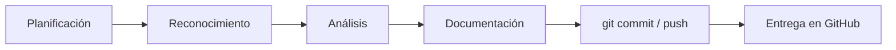

# Documentación técnica en Markdown para Ciberseguridad

## Curso de Especialización en Ciberseguridad en Entornos de las Tecnologías de la Información

**Serie de 5 prácticas progresivas · Git, GitHub y Markdown aplicados a la elaboración de informes técnicos**

---

## Objetivo de la serie

En el ámbito profesional de la ciberseguridad, el valor de un trabajo técnico depende en gran medida de cómo se **documenta y comunica**. Un hallazgo crítico mal redactado, una evidencia sin referenciar o un comando ilegible restan credibilidad al análisis y dificultan la toma de decisiones.

Esta serie tiene como finalidad que el alumnado adquiera soltura con **Markdown** como formato estándar para la redacción de informes, procedimientos y bitácoras técnicas, y con **Git/GitHub** como sistema de control de versiones y entrega.

> **Criterio fundamental:** estas prácticas no evalúan la profundidad técnica del contenido, sino la **corrección, estructura y claridad** del documento. El contenido es el vehículo; la calidad de la documentación es el objeto de evaluación.

---

## Aspectos que se evalúan

- Uso correcto de la **jerarquía de títulos**.
- Presentación de comandos, salidas y fragmentos de código en **bloques de código con lenguaje indicado**, nunca como texto plano ni como captura.
- Inclusión de **evidencias gráficas** con ruta relativa y texto alternativo descriptivo.
- Organización de datos comparativos y hallazgos en **tablas**.
- **Tratamiento adecuado de la información sensible** (véase el apartado siguiente).

---

## Normas de ética y tratamiento de la información

Todas las prácticas que impliquen el uso de herramientas de seguridad se realizarán **exclusivamente en el entorno de laboratorio** proporcionado por el centro o en máquinas virtuales propias. Queda prohibido documentar pruebas realizadas sobre sistemas de terceros sin autorización expresa.

Antes de publicar cualquier documento en GitHub:

1. **Enmascare** direcciones IP públicas, nombres de host reales y nombres de usuario (`192.168.56.XXX`, `usuario_redactado`).
2. **Nunca** incluya contraseñas, *hashes* reales, *tokens* ni claves privadas, ni siquiera de laboratorio.
3. **Revise** las capturas de pantalla: la información sensible también aparece en barras de título, pestañas y terminales.

> **Advertencia:** un repositorio público es indexado por buscadores. Una credencial subida por error debe considerarse comprometida aunque se elimine en un *commit* posterior, ya que permanece en el historial.

---

## Convención de entrega (común a las 5 prácticas)

Cada práctica se entrega en un **repositorio de GitHub** con el siguiente formato de nombre:

```text
CURSO-MODULO-SIGLASNOMBREAPELLIDOS-UDXX-PXX
```

| Campo | Valor | Ejemplo |
|---|---|---|
| Curso | `CECIB` | Curso de Especialización en Ciberseguridad |
| Módulo | Siglas del módulo | `INC` (Incidentes), `BAS` (Bastionado), `HE` (Hacking Ético), `AF` (Análisis Forense), `PPS` (Puesta en Producción Segura), `NOR` (Normativa) |
| Siglas | Iniciales del alumno/a | `MLR` |
| Unidad y práctica | `UDXX-PXX` | `UD00-P01` |

> Ejemplo: `CECIB-INC-MLR-UD00-P01`

**Procedimiento:**

1. Cree el repositorio en GitHub con el nombre indicado.
2. Clónelo en su equipo con `git clone`.
3. Redacte la práctica en un archivo **`README.md`**.
4. Siga el flujo: trabajar → `git add .` → `git commit -m "..."` → `git push`.
5. Realice un **mínimo de 3 *commits*** por práctica, con mensajes descriptivos.
6. Verifique en GitHub que el documento se visualiza correctamente.

---

# P01 — Perfil profesional del analista

---

## Contexto

El departamento va a mantener un **directorio interno del equipo de seguridad** en GitHub. Cada analista debe aportar una ficha con su perfil profesional, su formación previa y sus áreas de interés dentro de la ciberseguridad, de manera que el equipo pueda identificar rápidamente quién tiene experiencia en cada ámbito.

El contenido lo conoce usted mejor que nadie. El reto consiste en **maquetarlo con criterio profesional**.

---

## Contenido propuesto

- **Resumen profesional:** 3-4 frases. Motivación para cursar la especialización y expectativas.
- **Datos de contacto:** curso, grupo, correo corporativo del centro, usuario de GitHub.
- **Formación y experiencia previa:** ciclo de procedencia (ASIR, DAW, DAM, SMR...), experiencia laboral si la hubiera.
- **Áreas de interés:** 3-4 áreas ordenadas por preferencia (p. ej. análisis forense, *pentesting*, respuesta a incidentes, bastionado, *threat intelligence*).
- **Certificaciones objetivo:** certificaciones que le gustaría obtener (eJPT, CompTIA Security+, CEH, OSCP...).
- **Objetivo del curso:** una frase en *cursiva*.

---

## Requisitos mínimos (P01)

| Elemento Markdown | Uso exigido |
|---|---|
| `#` y `##` | Un único título principal; las secciones con `##` |
| Párrafos | Separados por línea en blanco |
| `**negrita**` | Al menos 2 usos con intención (datos clave) |
| `*cursiva*` | Al menos 1 uso (matización u objetivo) |
| Lista `-` | Mínimo 3 elementos |
| Lista `1.` | Mínimo 3 elementos en un orden con sentido (p. ej. áreas de interés por preferencia) |

**Repositorio:** `CECIB-MODULO-SIGLAS-UD00-P01`

---

## Estructura de referencia

```markdown
# Perfil profesional — [Nombre y apellidos]

## Resumen profesional

## Datos de contacto

## Formación y experiencia previa

## Áreas de interés

## Certificaciones objetivo

## Objetivo del curso
```

> **Nota:** no publique datos personales que no desee hacer públicos (teléfono, dirección, correo personal). Utilice siempre el correo del centro.

---

# P02 — Procedimiento operativo: comandos básicos de terminal y Git

---

## Contexto

Se incorpora al equipo un analista en prácticas sin experiencia en entornos de línea de comandos. Se le encarga a usted redactar un **procedimiento operativo estándar (POE)** que pueda consultar durante sus primeras semanas.

El documento debe ser claro y consultable de un vistazo: cada comando en su bloque de código, cada recomendación y advertencia debidamente destacada.

---

## Contenido obligatorio

Desarrolle estas 5 secciones:

1. **Navegación por el sistema de ficheros:** `pwd`, `ls -la`, `cd`
2. **Identificación del sistema y la red:** `whoami`, `hostname`, `ip a`
3. **Verificación de integridad de ficheros:** `sha256sum` (calcular el *hash* de un fichero y explicar para qué sirve en la cadena de custodia)
4. **Control de versiones — estado y registro de cambios:** `git status`, `git add .`, `git commit -m "..."`
5. **Control de versiones — sincronización con el repositorio remoto:** `git push`, `git pull`

Para cada comando: qué hace, **cuándo lo utilizaría** en una situación real de trabajo y, si procede, un ejemplo de salida.

---

## Requisitos mínimos (P02)

| Elemento Markdown | Uso exigido |
|---|---|
| Bloques ` ```bash ` | Uno por comando o grupo de comandos, **siempre** con lenguaje indicado |
| Bloques ` ```text ` | Al menos uno para mostrar la **salida** de un comando, separada del comando |
| Código en línea `` ` ` `` | Al mencionar un comando dentro de una frase: *"el comando `whoami`..."* |
| Citas `>` | Mínimo 2: una recomendación y una advertencia |
| Secciones `##` | Las 5 secciones del contenido obligatorio |

**Repositorio:** `CECIB-MODULO-SIGLAS-UD00-P02`

---

## Ejemplo del formato esperado

````markdown
## Verificación de integridad de ficheros

Antes de analizar una evidencia, se calcula su *hash* para poder
demostrar posteriormente que no ha sido alterada:

```bash
sha256sum evidencia.img
```

Salida obtenida:

```text
3f7a9c...e21b  evidencia.img
```

> **Recomendación:** registre el *hash* en la documentación en el
> momento de la adquisición, no después.
````

> Observe la separación de funciones: el **comando** en un bloque `bash`, la **salida** en un bloque `text`, la **explicación** en un párrafo y la **recomendación** en una cita.

---

# P03 — Bitácora de laboratorio con evidencias y referencias

---

## Contexto

Durante dos sesiones de laboratorio va a realizar una tarea técnica sencilla (por ejemplo, el despliegue de una máquina virtual, la configuración de un cortafuegos o un análisis con Wireshark de su propio tráfico). Se le requiere una **bitácora de laboratorio**: un registro cronológico de las actividades, acompañado de evidencias gráficas y de las fuentes consultadas.

Una bitácora con evidencias que no cargan o con referencias rotas carece de validez. En esta práctica se evalúa que **todo lo enlazado o insertado funcione y esté correctamente referenciado**.

---

## Contenido propuesto

1. **Sesión 1 — Preparación del entorno:** captura del estado inicial (p. ej. la máquina virtual recién desplegada).
2. **Fuentes consultadas:** 2-3 referencias de organismos o proyectos de referencia, por ejemplo:
   - [INCIBE — Instituto Nacional de Ciberseguridad](https://www.incibe.es)
   - [OWASP Foundation](https://owasp.org)
   - [MITRE ATT&CK](https://attack.mitre.org)
   - [Guías CCN-STIC del Centro Criptológico Nacional](https://www.ccn-cert.cni.es)
3. **Sesión 2 — Ejecución:** captura del resultado obtenido.
4. **Incidencia detectada y resolución:** un párrafo describiendo un problema encontrado y cómo se resolvió (puede ser simulado).

> Si aún no dispone de una tarea de laboratorio, documente el proceso de realización de la P02. El objeto de evaluación es la bitácora.

---

## Requisitos mínimos (P03)

| Elemento Markdown | Uso exigido |
|---|---|
| Imagen `` | 2 imágenes en la carpeta `img/`, con **texto alternativo que describa la evidencia** |
| Ruta relativa | `img/sesion1-entorno.png`, nunca `C:\Users\...\captura.png` |
| Enlace externo `[texto](URL)` | 2-3 enlaces con texto descriptivo (nunca "pinche aquí") |
| Lista numerada | Para la cronología de la bitácora |
| Fecha y hora | Cada entrada de la bitácora debe indicar fecha y hora (formato `AAAA-MM-DD HH:MM`) |
| Explicación propia | Un apartado que explique con sus palabras la diferencia entre enlace e imagen en Markdown |

**Repositorio:** `CECIB-MODULO-SIGLAS-UD00-P03`

---

## Estructura obligatoria del repositorio

```text
CECIB-MODULO-SIGLAS-UD00-P03/
├── README.md
└── img/
    ├── sesion1-entorno.png
    └── sesion2-resultado.png
```

> **Comprobación final:** abra el `README.md` en GitHub y verifique que **ambas imágenes se visualizan**. Revise también que ninguna captura muestre información sensible sin enmascarar.

---

# P04 — Informe comparativo de herramientas de seguridad

---

## Contexto

El equipo debe estandarizar las herramientas que se utilizarán en las prácticas del curso. Se le encarga la elaboración de un **informe comparativo** que servirá de base para la decisión.

Los datos comparativos dispersos en párrafos dificultan el análisis: **requieren una tabla**. En esta práctica se evalúa el dominio completo de la sintaxis de tablas: cabecera, separador, filas y alineación.

---

## Contenido obligatorio

Elija **una** de las siguientes categorías y compare las 3 herramientas indicadas:

| Categoría | Herramientas a comparar |
|---|---|
| Análisis de tráfico de red | Wireshark, tcpdump, TShark |
| Escaneo y reconocimiento | Nmap, Masscan, RustScan |
| Distribuciones de seguridad | Kali Linux, Parrot Security OS, BlackArch |
| Gestores de contraseñas | KeePassXC, Bitwarden, Pass |

Columnas sugeridas (puede añadir una más):

| Columna | Contenido |
|---|---|
| Licencia | Libre / Propietaria / *Freemium* |
| Plataformas | Windows, Linux, macOS |
| Interfaz | Gráfica / Línea de comandos / Ambas |
| Curva de aprendizaje | Baja / Media / Alta |

---

## Requisitos mínimos (P04)

| Elemento Markdown | Uso exigido |
|---|---|
| Tabla | Mínimo 4 columnas × 3 filas de datos (cabecera aparte) |
| Separador `\|---\|` | Sintaxis correcta en todas las columnas |
| Alineación | `:--` en una columna, `--:` en otra y `:-:` en otra (las tres) |
| Separadores `---` | Entre secciones: introducción / tabla / conclusión |
| Fuentes | Al menos 1 enlace a la documentación oficial de cada herramienta |
| Conclusión | Un párrafo que **justifique** la recomendación, con negrita en lo esencial |

**Repositorio:** `CECIB-MODULO-SIGLAS-UD00-P04`

---

## La conclusión es evaluable

La tabla presenta los datos; la conclusión **argumenta una recomendación**. Ejemplo del nivel esperado:

```markdown
## Conclusión y recomendación

Se recomienda **Wireshark** como herramienta principal para el curso,
por disponer de interfaz gráfica, filtros de visualización avanzados
y documentación extensa. **tcpdump** se mantiene como herramienta
complementaria para capturas en servidores sin entorno gráfico,
*especialmente en las prácticas del módulo de Bastionado*.
```

> Negrita donde hay una decisión; cursiva donde hay una matización.

---

# P05 — Práctica integral: informe técnico de laboratorio

---

## Contexto

Última práctica de la serie. Se simula la **entrega de un informe técnico real**, con la estructura que se exigirá en los módulos de la especialización (informes de incidente, de auditoría o de bastionado).

Hasta ahora se ha practicado cada elemento de forma aislada. En esta práctica debe demostrar que **los combina con criterio**, cada uno en el lugar que le corresponde, dentro de un documento con estructura profesional.

---

## Contenido propuesto (elija un trabajo YA REALIZADO)

No es necesario realizar un trabajo técnico nuevo. Documente uno existente, por ejemplo:

- La bitácora de la P03, reformulada como informe.
- El bastionado básico de una máquina virtual (actualización, usuarios, cortafuegos).
- Un escaneo de puertos con Nmap sobre una máquina **de su propio laboratorio**.
- Cualquier práctica de otro módulo del curso.

> Si debe elegir entre "un trabajo técnico más ambicioso" y "un informe mejor documentado", elija lo segundo. Es lo que se evalúa en esta práctica.

---

## Requisitos mínimos (P05)

| Elemento Markdown | Uso exigido |
|---|---|
| Ficha de control | Tabla inicial con autor, fecha, versión y clasificación del documento |
| Índice | Lista con enlaces internos a las secciones: `[Introducción](#1-introducción)` |
| Jerarquía completa | `#` → `##` → `###` sin saltar niveles |
| 2 bloques de código | Con lenguaje: `bash` y otro adecuado (`text`, `log`, `json`, `yaml`, `ini`...) |
| 1 imagen | En `img/`, con texto alternativo útil |
| Tabla de hallazgos | Con columnas de identificador, descripción, **severidad** y estado |
| 1 cita `>` | Una dificultad, limitación o recomendación destacada |
| 1 diagrama Mermaid | La metodología seguida o el flujo de trabajo con Git |
| Separadores `---` | Entre secciones principales |

**Repositorio:** `CECIB-MODULO-SIGLAS-UD00-P05`

---

## Estructura obligatoria del informe

```markdown
# [Título del informe]

| Campo | Valor |
|---|---|
| Autor/a | [Nombre y apellidos] |
| Fecha | AAAA-MM-DD |
| Versión | 1.0 |
| Clasificación | Uso interno / Docente |

## Índice

## 1. Resumen ejecutivo
## 2. Alcance y objetivos
## 3. Entorno y herramientas utilizadas
## 4. Metodología
## 5. Desarrollo
### 5.1. [Fase 1]
### 5.2. [Fase 2]
## 6. Hallazgos
## 7. Recomendaciones
## 8. Conclusiones
## 9. Referencias
```

> **Resumen ejecutivo:** debe poder entenderlo una persona sin conocimientos técnicos (p. ej. la dirección). Máximo un párrafo, sin comandos ni jerga.

---

## Ejemplo de tabla de hallazgos

```markdown
| ID | Descripción | Severidad | Estado |
|:--|:--|:-:|:-:|
| H-01 | Servicio SSH accesible con autenticación por contraseña | Media | Corregido |
| H-02 | Sistema operativo sin actualizaciones de seguridad | Alta | Pendiente |
| H-03 | Cortafuegos del sistema deshabilitado | Alta | Corregido |
```

> Para la severidad se recomienda utilizar la escala cualitativa de CVSS: **Crítica, Alta, Media, Baja, Informativa**.

---

## Diagrama Mermaid de partida



> No lo copie literalmente: adáptelo a la metodología real que ha seguido (fases concretas, herramientas, puntos de verificación). Se evalúa que **comprende** el proceso, no que reproduce el ejemplo.

---

# Criterios de evaluación comunes

---

## Rúbrica general (todas las prácticas)

| Criterio | Puntos |
|---|:-:|
| Repositorio con el nombre correcto | 1 |
| Flujo Git correcto (`clone`, `add`, `commit`, `push`) | 1 |
| Mínimo 3 *commits* con mensajes descriptivos | 1 |
| Elementos Markdown exigidos, utilizados correctamente | 4 |
| Documento claro, ordenado y con registro profesional | 2 |
| Tratamiento adecuado de la información sensible | 1 |

**Total: 10 puntos**

> **Criterio excluyente:** la publicación de credenciales, claves o datos personales de terceros supone la calificación de **0 puntos** en la práctica, con independencia del resto de criterios.

---

## Errores frecuentes

- Subir el `README.md` en un único *commit*.
- Insertar imágenes con rutas absolutas del equipo local (no se visualizan en GitHub).
- Bloques de código sin lenguaje indicado.
- Mezclar en el mismo bloque el comando y su salida.
- Utilizar `#` para todos los niveles de apartado.
- Presentar comandos o salidas como capturas de pantalla en lugar de texto (impide copiarlos y buscarlos).
- Enlaces con el texto "pinche aquí" en lugar de un texto descriptivo.
- Capturas de pantalla con IP, usuarios o *tokens* sin enmascarar.
- Registro coloquial impropio de un informe técnico.

---

## Referencia rápida de entrega

```bash
git status                                   # Revisar los cambios pendientes
git add .                                    # Preparar los cambios
git commit -m "Añade tabla de hallazgos"     # Registrar los cambios en local
git push                                     # Publicar en GitHub
git pull                                     # Sincronizar si trabaja desde otro equipo
```

> **Recuerde:** `commit` registra los cambios en su equipo; `push` los publica en GitHub. Antes de cada `push`, revise que no incluye información sensible.
